# RA-3 / RA-4 - Process hypothesis and assumptions

No department interviews or observed workflow were supplied. The following is the assignment's synthetic fallback, used for design only; it is not interview evidence or confirmed institutional policy.

## Synthetic scenarios

- S-C01, fictional coordinator: receives a notice, checks details, sends it to students, collects applications, asks the organization for a recommendation and communicates a decision; follows weekly notes separately. Hypothesized difficulty: finding unresolved decisions across tools.
- S-S01, fictional student: sees notices, applies through a form, checks email for progress, and sends a weekly note. Hypothesized difficulty: identifying the current state and next action.
- S-M01, fictional mentor: reviews applicants and later replies to progress notes. Hypothesized difficulty: identifying which student and learning goal a note concerns.

No dialogue, quotes, participant counts, timings or measured findings are invented. These scenarios support a provisional flow and interview questions only.

## Current-process hypothesis (as-is, unvalidated)

```mermaid
flowchart LR
  A[Organization sends notice] --> B[Coordinator checks notice]
  B --> C[Announcement shared]
  C --> D[Student submits application]
  D --> E[Applications consolidated]
  E --> F[Organization suggests decision]
  F --> G[Coordinator communicates outcome]
  G --> H[Selected student begins placement]
  H --> I[Student sends weekly note]
  I --> J[Mentor replies; coordinator follows up]
```

Actual tools, approval exceptions, communication channels and effort remain unknown. Disputed points register is empty because no interviews have occurred; empty is not evidence of consensus.

## Eight week-one assumptions

| ID | Assumption from proposal | Validation status | Consequence if false | Validation question / owner |
| --- | --- | --- | --- | --- |
| A1 | One department sponsors the demo | Unknown | Local fit and pilot access cannot be claimed | Confirm sponsor/access; coordinator |
| A2 | Coordinator approves every organization and opportunity | Unknown | Permission/approval workflow changes | Who vets each record? coordinator |
| A3 | Mentors are invited by coordinator | Unknown | Account provisioning changes | Who may invite mentors? coordinator |
| A4 | Student may apply to multiple opportunities | Unknown | Application eligibility rules change | Is multi-application allowed? coordinator/student |
| A5 | Coordinator confirms selection after organization recommendation | Unknown | Decision authority and trail change | Who makes final visible decision? coordinator |
| A6 | Selection creates exactly one linked placement | Unknown | Selection transaction/schema changes | Is placement automatic on confirmation? coordinator |
| A7 | Synthetic accounts and records are permitted | Unknown | Demo access and data approvals needed | Are synthetic demonstrations acceptable? supervisor |
| A8 | At most one active placement per student in MVP | Unknown | Concurrency and selection rules change | Confirm active-placement policy; coordinator |

All eight are Unknown with respect to stakeholder validation. They are proposed design defaults, not confirmed findings. After a real review mark Confirmed, Changed or Unknown, and attach evidence/date/reviewer; changes must identify affected FRs and test cases.

## To-be workflow

Invited representative drafts -> submits for review -> coordinator publishes or returns with explanation -> student browses open publication and applies once -> representative recommends -> coordinator confirms a valid visible transition and next step -> selection atomically creates placement and 2-3 goals -> student posts one goal-linked weekly note -> assigned mentor responds -> coordinator monitors pending and overdue records -> coordinator confirms completion after final check-in.

## Completed synthetic fallback walkthrough - 23 November 2026

The Member 1 assignment explicitly permits synthetic personas when department access is unavailable. This exercise uses that fallback. Real interviews conducted: zero. Real participants: zero. No timings, quotations or measured findings are claimed. The following are analyst-generated scenario notes for the prototype.

| Persona | Guide topics exercised | Scenario notes and design implications | Evidence classification |
| --- | --- | --- | --- |
| S-C01 synthetic coordinator | Approval, decisions, next steps, supervision, privacy | Trace a notice from completeness check through publication. Reject publishing a draft. Keep organization recommendation separate from final decision. Require a public reason/next step and preserve the prior trail. On selection, check one-active-placement and 2-3 goals. Review pending/overdue items. These steps exercise FR2/3/5/6/7/9 and the coordinator guide. Actual local tools, authority and workload remain unknown. | Synthetic desk walkthrough |
| S-S01 synthetic student | Discover, eligibility/deadline, apply, status comprehension, weekly burden | Trace one open listing to a single application and receipt. Exercise duplicate and exact-deadline rejection. Read a confirmed status and next action. Open placement/goals, submit one goal-linked note and read mentor feedback. These steps exercise FR4/6/7/8 and student guide topics. Real comprehension, timing and usability remain unmeasured. | Synthetic desk walkthrough |
| S-M01 synthetic representative/mentor | Drafting, recommendations, assigned feedback, record boundaries | Create a partial own-organization draft, complete and submit it, read a return reason and resubmit. View own applicants and recommend an outcome. After coordinator selection, read only assigned placement/check-ins and respond. Exercise cross-organization and unassigned-mentor denial as intended outcomes. These steps exercise FR1/2/5/8. Actual mentor participation remains unknown. | Synthetic desk walkthrough |

### Disputed and unresolved points register

| ID | Point needing validation | Current record | Affected work |
| --- | --- | --- | --- |
| U1 | Actual department process, sponsor and approval authority | Unknown. The as-is diagram remains a hypothesis. | A1/A2/A5, local-fit claims |
| U2 | Mentor invitations and organization membership policy | Prototype uses invited ORG_REP mentor assignment and one organization per rep. Department confirmation unknown. | A3, FR1/FR8 |
| U3 | Multiple applications and one active placement | Prototype allows multiple distinct applications and one active placement. Department confirmation unknown. | A4/A8, FR4/FR7 |
| U4 | Recommendation before decline | Member 1 clarified no prerequisite for decline from Under Review/Shortlisted. Selection requires a recorded recommendation. Whole-team approval pending. | A5, FR5/FR6/FR7 |
| U5 | Final check-in and one feedback per check-in | Team decisions pending. No synthetic persona is treated as an approver. | FR8, completion tests |
| U6 | Live-data retention and research access | No approved retention date, consented participants or live data supplied. Use synthetic demo records. | NFR2, RA-1/RA-15 |

There are no participant disagreements to report because no participant interviews occurred. U1-U6 document unresolved design/policy questions found in the fallback exercise.

### RA-4 reconciliation

The as-is hypothesis and to-be flow above were checked against all three synthetic scenarios. All eight assumptions have an explicit Unknown status for department validation, plus a consequence and validation question/owner. Prototype design decisions in KAN-18/KAN-45 do not change their empirical validation status. This completes the current-process draft and assumptions-log deliverable while preserving the department-validation limitation.

RA-3 is delivered using the assignment's synthetic fallback. RA-4's status-label criterion is satisfied for A1-A8. Team requirements-baseline sign-off remains separately tracked in RA-7/KAN-19. The earlier extra condition requiring explicit acceptance before using the assignment-authorized fallback is superseded by this record.
